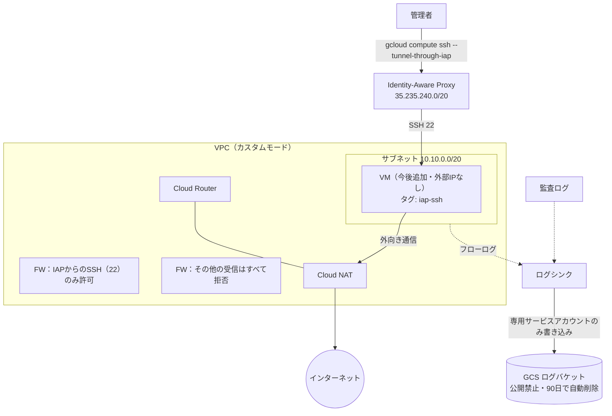

# terraform-gcp-baseline

Google Cloud に小さく安全な土台環境を作る Terraform コードです。
外部 IP を持たない VM を前提に、IAP 経由の SSH だけを許可するゼロトラスト型の入口と、
ログの保管までを最小構成でまとめています。

## 構成図



## 作られるもの

| リソース | 内容 |
| --- | --- |
| API | Compute Engine・IAP・Cloud Logging を有効化 |
| VPC | カスタムモードの VPC とサブネット（限定公開の Google アクセス有効、フローログ有効） |
| Cloud NAT | 外部 IP なしの VM が外部に出るための NAT |
| ファイアウォール | IAP の送信元からの SSH（タグ `iap-ssh`）のみ許可、それ以外の受信は拒否 |
| GCS（ログ） | 公開禁止・均一アクセス・バージョニング・90 日で自動削除 |
| ログシンク | フローログと監査ログを GCS に保存（書き込み権限はシンク専用のサービスアカウントのみ） |

ネットワークは `modules/network` にモジュールとして分けています。

## 費用について

VM は作らないため、費用はごくわずかです（ログの保存量と Cloud NAT の利用分）。
試した後は `terraform destroy` で削除してください。

## 使い方

```bash
gcloud auth application-default login
cp terraform.tfvars.example terraform.tfvars   # プロジェクト ID を編集
terraform init
terraform plan
terraform apply
terraform destroy   # 片付け
```

サービスアカウントキー（JSON）は使わず、`gcloud auth application-default login` で認証してください。
キーファイルをリポジトリに置かないでください。

## CI

GitHub Actions で、push と Pull Request のたびに次を自動実行します（GCP の認証情報は不要）。

- `terraform fmt -check`（書式）
- `terraform validate`（構文）
- `tflint`（静的解析）

## 今後の拡張

- state を GCS に移す（`versions.tf` にコメントで用意済み）
- GitHub Actions から Workload Identity 連携で GCP に接続し、Pull Request で `terraform plan` を表示
- IAP 経由でのみ入れる踏み台 VM の追加
